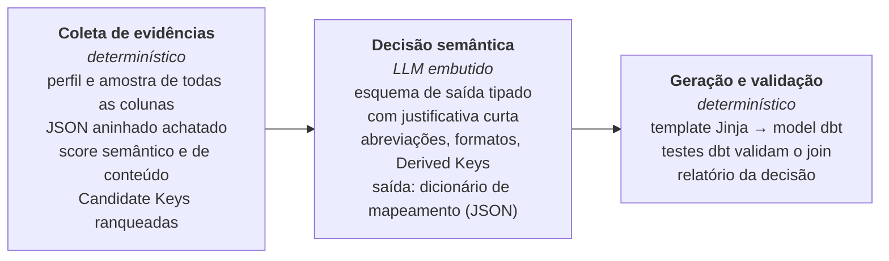
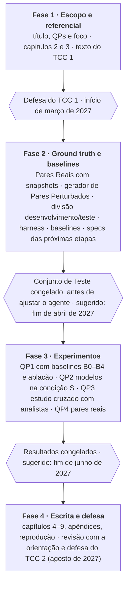

# Proposta de TCC — Integração de dados públicos com modelos de linguagem

Autora: Luiza Maluf (UnB/FCTE) · Orientação: Carla Rocha e Isaque Alves · versão de 2026-11-15 · documento vivo, atualizar junto com as decisões.

**Calendário:** defesa do TCC 1 no início de março de 2027; defesa do TCC 2 em agosto de 2027; pôster no CAIN 2027 (ver "Cronograma").

Artigo-base: ver [`artigo-base.md`](artigo-base.md). Decisões de arquitetura: [`docs/adr/`](https://github.com/LuizaMaluf/Integracao-de-Dados-com-Modelos-de-Linguagem/tree/main/docs/adr).

## Visão geral

**Título:** *Integração de dados públicos com modelos de linguagem: um pipeline construído por Spec-Driven Development para descoberta de chaves entre bases governamentais*

O repositório sustenta um TCC de **engenharia de dados aplicada ao setor público** com dois pilares: (1) um pipeline em que um modelo de linguagem, embutido entre estágios determinísticos, descobre chaves de integração entre bases governamentais; (2) a construção desse pipeline por **Spec-Driven Development** com agente de IA, avaliada como parte da pesquisa.

**Motivação: interoperabilidade.** Bases do governo federal (SIAFI, Transferegov, Portal da Transparência, IBGE) têm baixa interoperabilidade semântica: usam nomes, formatos e identificadores diferentes para os mesmos conceitos — por exemplo, a Nota de Empenho no formato curto `2023NE000123` e o identificador SIAFI completo — e raramente declaram uma chave comum. Das 29 condições de join entre fontes levantadas no código do Gov Hub (`inventario-govhub.md`), só uma é igualdade direta entre colunas sem transformação.

**Problema.** Por isso, cruzar duas bases exige descobrir a chave de junção à mão, com conhecimento de domínio, a cada novo par de bases. Na experiência do time do Gov Hub, determinar como duas bases federais interoperam leva de dois a três meses, e o trabalho se repete a cada novo par de fontes.

**Tese.** Um LLM consegue descobrir essas chaves com segurança se só fizer escolhas que código consegue checar. O TCC chama esse princípio de **bounded agency**: o modelo decide só o que exige julgamento, e artefatos que ele não produziu (o Catálogo de Transformações, checagens executáveis, uma spec revisada) restringem e checam a decisão. O princípio vale em dois níveis. Em *run time*, o LLM escolhe a Integration Key dentro do catálogo fechado ou se abstém, e estágios determinísticos geram e checam o join. Em *build time*, o agente de código implementa o pipeline a partir de uma spec revisada por pessoas, e testes-oráculo escondidos dele checam o resultado. O desenho parte do SPAPI-Tester (artigo-base), que manteve um processo de teste industrial, usou LLM em cada etapa manual discreta, inclusive para gerar os casos de teste, e deixou a renderização e a execução dos testes em código determinístico. Aqui o LLM decide uma etapa só, o de-para entre as bases.

**Fora do foco.** A ingestão das bases é feita pelo Gov Hub (`data-application-gov-hub`), que já carrega os sistemas em schemas do PostgreSQL; este repositório lê de lá (`PostgresLoader`) ou de snapshots datados exportados de lá. A pilha de ingestão própria (Airflow, MinIO, costuras A/B/C) foi removida em 2026-10-03 e está registrada em `docs/historico/` e nas ADRs 0001–0010, descontinuadas.

## Artigo-base: SPAPI-Tester

*Automating a Complete Software Test Process Using LLMs: An Automotive Case Study* (Wang, Yu, Feldt e Parthasarathy; Chalmers e Volvo Group; ICSE 2025, pp. 373-384) automatiza um processo de teste automotivo cujas etapas manuais incluíam o mesmo problema que este repo trata em dados públicos: um "de-para" entre fontes em silos que só especialistas experientes faziam. O artigo mantém as etapas do processo, usa LLM em cada etapa manual discreta (extrair e organizar a informação dos silos, mapear, gerar os casos de teste) e deixa a renderização e a execução dos testes em código determinístico. O TCC segue o artigo em três pontos: LLM embutido no processo, não no lugar dele; saída tipada consumida por templates; desenho da avaliação. E acrescenta a restrição da bounded agency: só uma etapa usa o LLM, e a decisão dele é checada por artefatos que ele não produziu. Resumo completo em [`artigo-base.md`](artigo-base.md).

| Aspecto | No artigo | No TCC |
| --- | --- | --- |
| Domínio | Testes de APIs de caminhões (Volvo) | Integração de bases do governo federal |
| Fontes em silos | Swagger, tabelas de sinais CAN, Veículo Virtual | SIAFI, Transferegov, Portal da Transparência, IBGE |
| O "de-para" | Propriedade da API → sinal CAN → estado do veículo virtual | Coluna da base A → coluna da base B (Integration Key) |
| Atritos | Erros ortográficos, abreviações (`STANDARD` → `STD`), formatos, equivalências lógicas (`OFF` = `NOT_ON`), semânticas, unidades, pseudocódigo | Ver **Categoria de atrito** em [`CONTEXT.md`](https://github.com/LuizaMaluf/Integracao-de-Dados-com-Modelos-de-Linguagem/blob/main/CONTEXT.md); sem a categoria de unidades, que não aparece em chaves, e com Derived Key e Estrutura aninhada, que o artigo não tem |
| Escopo do de-para | Todas as propriedades da API | Só a Integration Key; o mapeamento das demais colunas equivalentes fica como trabalho futuro |
| Uso do LLM | Em cada etapa manual discreta, inclusive para gerar os casos de teste; DSPy: assinatura tipada, `ChainOfThought`, autocorreção quando o parsing falha | Numa etapa só, o de-para; `llm_reasoner` hoje usa prompt direto; migrar para DSPy, com autocorreção só para saída inválida (ADR 0011) |
| Saída do LLM | Dicionário JSON unificado, com mapeamento de valores e casos de teste como dados; o script de teste sai do template | Dicionário de Mapeamento: Integration Key (ou Abstenção), transformações do Catálogo de Transformações (fechado, ADR 0013) e cardinalidade esperada; o LLM nunca escreve o SQL |
| Estágio determinístico | Templates Jinja → script PyTest, executado por código | Templates Jinja → model dbt de join + testes dbt e checagens da decisão (ADR 0011) |
| Avaliação | Tempo por API (engenheiro × ferramenta), cobertura, taxa de sucesso por modelo, precisão por categoria de atrito, APIs reais e bugs encontrados | Tempo e acurácia do analista sozinho × assistido pelo pipeline, acurácia por modelo, acurácia por categoria de atrito, pares reais com chave confirmada e barreiras de interoperabilidade encontradas |

O LLM decide o de-para e devolve dados estruturados; quem gera e executa o SQL é código determinístico, como o Jinja e o PyTest no artigo. Como no artigo, o estágio anterior reúne a informação e não filtra as respostas: os Candidate Keys ordenam as opções, mas o LLM pode propor uma chave fora da lista (composta ou derivada), que o estágio determinístico valida executando o join.

**Números do artigo.** A apresentação de referência cita, por exemplo, 11 s por API contra 2 h a 3 dias, taxa de sucesso de 98% e 193 APIs com 22 bugs. Citar esses valores a partir do artigo (ICSE 2025), não dos slides.

## Questões de pesquisa e objetivos

| Questão | Pergunta | Como responder | No artigo |
| --- | --- | --- | --- |
| QP1 | Por categoria de atrito, o que o LLM acrescenta sobre B2 e como se compara com B4? | Pares de Avaliação com Gabarito, inclusive Pares Negativos, rotulados por categoria de atrito; Acerto de Chave, Acerto de Execução e Matriz de decisão; S contra os baselines B0–B4 | Precisão por categoria (ortografia, lógica, unidades, pseudocódigo) |
| QP2 | Um modelo de pesos abertos hospedado localmente alcança um modelo proprietário? | Os mesmos pares com 2 ou 3 modelos, ao menos um aberto | LLaMA3 70B no nível do GPT-4o; para governo, pesa por soberania de dados e LGPD |
| QP3 | O pipeline torna o analista mais rápido e mais certeiro na descoberta da chave, e a que custo? | Estudo cruzado: analistas do Gov Hub resolvem Pares Reais metade sozinhos e metade revisando a saída do pipeline; tempo até declarar a chave e acurácia pelo Gabarito; tokens, latência e custo do pipeline à parte | Tempo por API: engenheiro sênior × ferramenta |
| QP4 | Em pares reais que o Gov Hub ainda não integra, o pipeline descobre chaves que quem conhece as bases confirma? | Rodar em pares reais novos e contar chaves confirmadas e Abstenções corretas; os achados (Categorias de Atrito encontradas, pares sem chave comum, problemas que aparecem ao executar o join) alimentam a discussão sobre interoperabilidade | APIs inéditas testadas e bugs genuínos encontrados |
| QP5 | A spec completa melhora o que o agente entrega, medido por oráculos escondidos? | Cada incremento avaliado é implementado duas vezes pelo mesmo agente, a partir do mesmo commit — com a spec completa e só com o Problema e o Contrato mínimo —; oráculos compartilhados e de critério, escritos pela autora antes e escondidos do agente, medem os dois braços; comparar correção, intervenções e tempo, incluindo o de escrever a spec | — (o artigo preserva o processo e embute o LLM nele; o SDD faz o mesmo no desenvolvimento: a spec é a estrutura, o agente implementa) |

No artigo submetido ao CAIN 2027 (pôster), RQ1 = QP1 e RQ2 = QP5; as QP2 a QP4 ficam só no TCC.

**Objetivo geral.** Propor, implementar por Spec-Driven Development e avaliar um pipeline que use modelos de linguagem embutidos entre estágios determinísticos para descobrir chaves de integração entre bases governamentais heterogêneas.

**Objetivos específicos:**

1. Implementar a Decision Layer com um LLM embutido via DSPy (esquema de saída tipado com justificativa curta, autocorreção para saída inválida), com Abstenção, chaves propostas fora da lista de candidatos e Catálogo de Transformações (ADRs 0011 e 0013).
2. Implementar o estágio determinístico que gera, a partir do Dicionário de Mapeamento, o model dbt de join e seus testes.
3. Construir o benchmark de chaves de integração: Pares Reais anotados e gerador de Pares Perturbados, rotulados por categoria de atrito.
4. Avaliar acurácia, comparação entre modelos, tempo e custo e aplicação em pares reais, contra baselines (QP1–QP4).
5. Construir o pipeline por Spec-Driven Development com agente de IA e avaliar esse processo por comparação pareada (QP5).

**Contribuições esperadas:**

- Pipeline aberto e reproduzível de descoberta de chaves com LLM embutido: saída tipada, Catálogo de Transformações e validação por execução, com decisões registradas em ADRs.
- Benchmark de chaves de integração em bases públicas brasileiras, rotulado por categoria de atrito: Pares Reais anotados e um gerador reproduzível de Pares Perturbados.
- Mapa de Fluxo dos dados orçamentários federais em nível de política (documentos, sistemas, identificadores e elos, com as normas), reutilizável pelo Gov Hub e independente do pipeline.
- Aplicação do padrão do SPAPI-Tester em outro domínio (dados públicos), sob bounded agency, com evidência de quando o LLM ajuda e quando não, e de quanto o contexto do fluxo do dado pesa nesse acerto.
- Evidência pareada do efeito do SDD com agente de IA na construção de um pipeline de dados (com spec × sem spec, medida por testes-oráculo).

## Estrutura da monografia

| Cap. | Título | Conteúdo | Material no repo |
| --- | --- | --- | --- |
| 1 | Introdução | Motivação (interoperabilidade), problema, justificativa, QPs, objetivos, contribuições | `README.md`, `docs/tcc/index.html` |
| 2 | Fundamentação teórica | Interoperabilidade e dados abertos no setor público, integração de dados, schema matching, perfilamento, LLMs, Spec-Driven Development | Seção de referencial abaixo |
| 3 | Trabalhos relacionados | Matching, LLMs para dados, artigo-base; tabela comparativa | `docs/tcc/artigo-base.md` |
| 4 | Metodologia | DSR com estudo de caso; SDD como processo de construção; ciclos, PoC IBGE, protocolo de avaliação | `docs/specs/`, histórico de commits |
| 5 | Pipeline proposto | Coleta de evidências, Decision Layer com LLM embutido, Dicionário de Mapeamento e Catálogo de Transformações, estágio Jinja → dbt; a ingestão é do Gov Hub | ADR 0011, `CONTEXT.md` |
| 6 | Implementação | Stack (Python, DSPy, dbt, PostgreSQL, LLM proprietário e de pesos abertos), módulos, testes, reprodutibilidade | `src/govhub/`, `tests/`, `dbt/` |
| 7 | Avaliação e resultados | QP1 acurácia por categoria de atrito, QP2 modelos abertos × proprietários, QP3 tempo e custo, QP4 pares reais, QP5 SDD | Harness de avaliação, resultados JSON, registros das specs |
| 8 | Discussão | Achados, o que eles revelam sobre a interoperabilidade das bases, limitações, ameaças à validade, implicações para o Gov Hub | — |
| 9 | Conclusão | Respostas às QPs, contribuições, trabalhos futuros | — |

**Apêndices:** glossário (de `CONTEXT.md`), ADRs, Catálogo de Transformações, prompts/assinaturas da Decision Layer, protocolo da QP5 e registros das specs, instruções de reprodução.

Achado de ancoragem para o capítulo 7: no par IBGE sem LLM, a Decision Layer escolheu `nome ↔ nome`. A chave correta é o código da UF (prefixo do código do município e também aninhado no JSON) — um caso de Derived Key em que a comparação com e sem LLM deve mostrar diferença.

## Referencial teórico

Referências clássicas por eixo, listadas de memória: **confirmar autor, ano e veículo antes de citar**, e complementar com trabalhos de 2023 em diante sobre LLMs e matching.

| Eixo | Referência | Para que serve no TCC |
| --- | --- | --- |
| Artigo-base | Wang, Yu, Feldt e Parthasarathy (2025), *Automating a Complete Software Test Process Using LLMs: An Automotive Case Study*, ICSE, pp. 373-384 | Modelo da tese, da arquitetura e da avaliação |
| LLMs como programa | Khattab et al. (2024), *DSPy: Compiling Declarative Language Model Calls into Self-Improving Pipelines*, ICLR | Esquema de saída tipado com justificativa curta e autocorreção na Decision Layer |
| Integração de dados | Lenzerini (2002), *Data integration: a theoretical perspective*, PODS | Definição formal de integração |
| Integração de dados | Doan, Halevy e Ives (2012), *Principles of Data Integration*, Morgan Kaufmann | Livro-texto: matching, mapeamento, heterogeneidade |
| Integração de dados | Halevy, Rajaraman e Ordille (2006), *Data integration: the teenage years*, VLDB | Panorama e desafios abertos |
| Schema matching | Rahm e Bernstein (2001), *A survey of approaches to automatic schema matching*, VLDB Journal | Taxonomia schema-based × instance-based das evidências |
| Schema matching | Madhavan, Bernstein e Rahm (2001), *Generic schema matching with Cupid*, VLDB | Matching por nome e estrutura (score semântico) |
| Schema matching | Melnik, Garcia-Molina e Rahm (2002), *Similarity Flooding*, ICDE | Contraste com a abordagem do TCC |
| Descoberta de dados | Koutras et al. (2021), *Valentine*, ICDE | Benchmark, método de geração de pares por perturbação e baseline B1 |
| Schema matching | Do e Rahm (2002), *COMA: a system for flexible combination of schema matching approaches*, VLDB | Método do baseline B1 |
| Descoberta de dados | Fernandez et al. (2018), *Aurum*, ICDE | Descoberta de tabelas relacionadas |
| Perfilamento | Abedjan, Golab e Naumann (2015), *Profiling relational data: a survey*, VLDB Journal | Base do `analisar-tabela` |
| Record linkage | Fellegi e Sunter (1969), *A theory for record linkage*, JASA | Distingue chave de integração de linkage de registros |
| Record linkage | Christen (2012), *Data Matching*, Springer | Normalização de identificadores |
| LLMs | Brown et al. (2020), *Language models are few-shot learners*, NeurIPS | Aprendizado em contexto |
| LLMs | Narayan et al. (2022), *Can foundation models wrangle your data?*, PVLDB | LLMs em tarefas de dados |
| LLMs | Lewis et al. (2020), *Retrieval-augmented generation*, NeurIPS | Domain Context (Glossário e Mapa de Fluxo) como conhecimento injetado |
| Engenharia de dados | Reis e Housley (2022), *Fundamentals of Data Engineering* | Contexto: ciclo de vida dos dados, ELT |
| Spec-Driven Development | Böckeler (2025), *Understanding Spec-Driven-Development: Kiro, spec-kit, and Tessl*, martinfowler.com | Panorama e críticas do SDD com agentes de IA |
| Spec-Driven Development | GitHub (2025), *Spec Kit*, github.com/github/spec-kit | Fluxo de referência spec → plano → tarefas → implementação |
| Especificação | Meyer (1992), *Applying "Design by Contract"*, IEEE Computer | Contrato como especificação verificável |
| Especificação | Adzic (2011), *Specification by Example*, Manning | Critérios de aceite como exemplos verificáveis |
| Eng. de software | Evans (2003), *Domain-Driven Design* | Linguagem ubíqua (`CONTEXT.md`) |
| Eng. de software | Nygard (2011), *Documenting Architecture Decisions* | Formato de ADR |
| Metodologia | Hevner et al. (2004), MIS Quarterly; Peffers et al. (2007), JMIS; Wieringa (2014) | Design Science Research |
| Metodologia | Wohlin et al. (2012), *Experimentation in Software Engineering* | Ameaças à validade |
| Estatística | Efron e Tibshirani (1993), *An Introduction to the Bootstrap*; McNemar (1947), Psychometrika; Holm (1979), Scandinavian Journal of Statistics; Wilson (1927), JASA | Plano de análise: bootstrap pareado, McNemar, correção de Holm, intervalo de Wilson |
| Interoperabilidade | Comissão Europeia (2017), *New European Interoperability Framework* (EIF) | Camadas legal, organizacional, semântica e técnica; situa o TCC na camada semântica |
| Interoperabilidade | e-PING — Padrões de Interoperabilidade de Governo Eletrônico (Governo Federal) | Referencial brasileiro de interoperabilidade |
| Interoperabilidade | Decreto 10.046/2019 (governança no compartilhamento de dados) | Compartilhamento de dados na administração federal |
| Governo e dados abertos | Lei 12.527/2011 (LAI), Decreto 8.777/2016, Lei 14.129/2021, Lei 13.709/2018 (LGPD) | Marco legal e limites |
| Governo e dados abertos | Janssen, Charalabidis e Zuiderwijk (2012), Information Systems Management | Barreiras ao uso de dados abertos |
| Domínio orçamentário | Documentação do SIAFI, Tesouro Nacional, Portal da Transparência, Transferegov | Formatos de NE, UG, convênio |

Citados pelo artigo-base (área de testes; usar só se o TCC discutir o paralelo): Kim et al., *Leveraging Large Language Models to Improve REST API Testing*; Golmohammadi, Zhang e Arcuri, *Testing RESTful APIs: A Survey*; Zhang, Marculescu e Arcuri, *Resource-based Test Case Generation for RESTful Web Services*.

Onde buscar o que falta: VLDB, SIGMOD, ICDE (LLMs para matching); ICSE, FSE e arXiv (SDD e agentes de IA de código — literatura acadêmica ainda escassa); SBBD e BDBComp (trabalhos brasileiros); Portal de Periódicos CAPES.

## Trabalhos relacionados e posicionamento

O diferencial não é um matcher melhor, e sim juntar o que costuma aparecer separado: bounded agency (o LLM escolhe dentro de um catálogo fechado ou se abstém, e código gera e checa o join), Domain Context com o fluxo do dado, avaliação por categoria de atrito em dados públicos brasileiros e um processo de construção (SDD) avaliado junto com o artefato.

Trabalhos que o posicionamento precisa discutir (os que estão sem autor ou veículo: **confirmar antes de citar**):

- **Transformação de valores.** FlashFill (POPL 2011) e TDE (PVLDB 2018) sintetizam transformações a partir de exemplos. Auto-Join (Zhu, He e Chaudhuri, PVLDB 2017) busca transformações sintáticas para o join sem exemplos, mas equivalências de código e identificadores em texto livre irregular exigem conhecimento de domínio. TabulaX: confirmar.
- **Join e descoberta com LLM.** QJoin e MetaJoin são a v1 e a v2 do mesmo preprint (Wang e Galhotra, arXiv:2512.02444). A v1 busca numa biblioteca fechada de operadores, sem LLM; a v2 usa um controlador LLM (Qwen3-8B) para rotear entre especialistas de join e verificar a saída deles. Nas duas, o algoritmo sempre devolve um join, e não existe a saída "não há chave". EcoTable, Scalable Join Inference, DBAutoDoc e *LLM Driven Smart Assistant for Data Mapping* (ICSE-SEIP 2025): confirmar.
- **LLM como componente de sistema.** Shao et al. (ICSE 2025, pp. 1178-1190), *Are LLMs correctly integrated into software systems?*, mostram que costuma ficar indefinido o que o LLM decide e como a saída é checada. Marquez Ayala (CAIN 2025, pp. 279-280) trata decomposição de tarefas e RAG como padrões de projeto de sistemas com LLM.

**Abstenção: formular com cuidado.** O EcoTable já conclui que não há caminho de join entre tabelas, então "não existe chave" como resposta não é inédito. O que o TCC acrescenta é a Abstenção como saída da descoberta de chave avaliada contra Pares Negativos, com Abstenções corretas e erradas relatadas à parte na Matriz de decisão, e a Abstenção como destino de toda decisão que o catálogo não expressa ou que falha numa checagem.

| Abordagem | Exemplo | Descobre a chave | Usa conteúdo (valores) | Usa LLM | Valida executando | Processo de construção avaliado |
| --- | --- | --- | --- | --- | --- | --- |
| Matchers clássicos | Cupid, Similarity Flooding, COMA | Sim (esquema) | Parcial | Não | Não | Não |
| Benchmarks de matching | Valentine | Avalia | Sim | Não | Não | Não |
| Descoberta em data lakes | Aurum | Tabelas relacionadas | Sim | Não | Não | Não |
| LLMs para dados | Narayan et al. (2022) | Sim (tarefa isolada) | Sim | Sim | Não | Não |
| Join com LLM controlador | MetaJoin (QJoin na v1) | Sempre devolve um join, sem Abstenção | Sim | Sim (v2) | Verifica a saída dos especialistas | Não |
| LLM embutido em processo industrial | SPAPI-Tester (artigo-base) | De-para entre documentos e geração dos casos de teste | Não (documentação) | Sim, em cada etapa manual | Sim (PyTest, por código) | Não |
| **Este TCC** | Gov Hub | Sim, com Derived Keys ou Abstenção | Sim | Sim, numa etapa só (bounded agency) | Sim (dbt e checagens) | Sim (SDD, QP5) |

Posicionar pela combinação e pelo domínio, não por "não existe nada igual".

## Metodologia

**Design Science Research com estudo de caso**, como no artigo-base: a DSR organiza construção e avaliação do artefato; o estudo de caso real (bases do Gov Hub) dá a validação fora do ambiente controlado. O histórico do repo registra os ciclos (skills da Fase 01 → pacote com Decision Layer → pilha de ingestão própria, depois removida; ver `docs/historico/`) e as ADRs registram as decisões. Princípio adotado: bounded agency — o LLM entra sem mudar o fluxo de trabalho do analista e decide só a etapa que exige julgamento, dentro de artefatos que ele não produziu.

**Spec-Driven Development (SDD) como foco do processo.** A DSR é o método de pesquisa; o SDD é como o artefato é construído e também objeto de avaliação (QP5). Cada ciclo segue: (1) spec em `docs/specs/` com problema, escopo, contrato e critérios de aceite verificáveis (modelo em `docs/specs/_template.md`); (2) plano; (3) implementação por agente de IA a partir da spec; (4) validação contra os critérios e os testes; (5) ADR quando há decisão de arquitetura. É o nível de *build time* da bounded agency: a spec, revisada por pessoas, é a estrutura fixa; o agente só preenche a implementação, e oráculos escondidos dele checam o resultado.

**Desenho da QP5: comparação pareada.** Registrar só que "com spec, o agente cumpriu a spec" não mede o efeito do SDD: o agente vê os critérios e escreve os próprios testes, e não há referência do que faria sem spec. Por isso, em cada incremento avaliado:

1. A autora escreve a spec e os **testes-oráculo** antes de qualquer implementação, fora do workspace do agente, em dois grupos: **oráculos compartilhados**, derivados do Problema e do Contrato mínimo, que os dois braços recebem; e **oráculos de critério**, derivados dos critérios de aceite.
2. O incremento é implementado em dois braços, em worktrees separados a partir do mesmo commit, com o mesmo agente e a mesma versão de modelo, em ordem sorteada: **com spec** (spec completa) e **sem spec** (o *Problema* e um **Contrato mínimo** de invocação e saída, iguais nos dois braços). Só o braço com spec recebe os critérios de aceite.
3. Intervenções padronizadas: até K rodadas em que a autora só relata o comportamento observado, sem dica de implementação; cada intervenção é registrada literalmente.
4. Os dois grupos de oráculos rodam nos dois braços e são relatados à parte: os de critério podem favorecer o braço com spec, que viu os critérios. Só o braço com spec entra no repositório — o artefato continua construído por SDD.

"Qualidade verificável" passa a ser três medidas: correção (oráculos passando, por grupo), autonomia (intervenções) e custo (tempo da autora, incluindo escrever a spec, e tokens). O resultado principal é a diferença pareada (com spec − sem spec) por incremento, resumida pela mediana. O protocolo da QP5 é ele mesmo uma spec em `docs/specs/`, congelada antes do primeiro incremento avaliado, pela mesma lógica do Conjunto de Teste.

| QP | Experimento | Métricas | Baseline |
| --- | --- | --- | --- |
| QP1 | Decision Layer nos Pares de Avaliação, rotulados por categoria de atrito | Cobertura de Candidatos (teto do pipeline sem LLM); Acerto de Chave (top-1) e Acerto de Execução (precisão, recall e F1), geral e por categoria; Matriz de decisão (Abstenções corretas e erradas, à parte do Acerto de Chave); recall contra a cascata inteira nos pares com cascata, como medida secundária; fração das chaves certas propostas fora da lista; MRR só para os baselines que produzem ranking | B0 a B4 (abaixo) |
| QP2 | QP1 na condição S, no nível Glossário + Mapa de Fluxo, com 2 ou 3 modelos, ao menos um de pesos abertos rodando localmente | Taxa de sucesso por modelo, tokens, latência | Modelo proprietário |
| QP3 | Desenho cruzado: 2 ou 3 analistas do Gov Hub (nunca a autora, sem acesso ao Gabarito) resolvem 6 a 8 Pares Reais do Conjunto de Teste; cada um faz metade sozinho e metade revisando o Dicionário de Mapeamento do pipeline, com a divisão trocada entre analistas para controlar dificuldade do par e aprendizado | Tempo até declarar chave e transformação (teto de 60 min por par; acima disso, "não resolvido"); Acerto de Chave e Acerto de Execução pelo Gabarito; `timings_s`, tokens, custo em R$ do modelo proprietário e tempo de máquina do local; horas para escrever e revisar o Catálogo de Transformações e o Mapa de Fluxo | Analista sozinho |
| QP4 | Pipeline aplicado aos pares que o Gov Hub ainda não integra (dez candidatos em `inventario-govhub.md`: PNCP × Compras.gov, SIAFI API × Tesouro Gerencial, SICONV × IBGE, PPA × SIAFI, Ancine × SALIC, …); as FKs documentadas e não implementadas do MGI formam um subgrupo com gabarito documentado | Chaves confirmadas por quem conhece as bases; Abstenções corretas; achados de interoperabilidade (atritos, pares sem chave comum, problemas ao executar o join) para a discussão | — |
| QP5 | Comparação pareada em 6 a 8 incrementos (ex.: Abstenção, Catálogo de Transformações, DSPy, Jinja → dbt, gerador de Pares Perturbados, harness, baselines): o mesmo incremento em dois braços, a partir do mesmo commit, com o mesmo agente e modelo — um recebe a spec completa, o outro o *Problema* e o Contrato mínimo | Oráculos compartilhados e de critério passando, relatados à parte, na primeira entrega e ao final; iterações; intervenções; tokens; tempo da autora, incluindo escrever a spec; diferença pareada mediana por incremento (descritiva e Wilcoxon) | Braço sem spec do mesmo incremento |

**Baselines.** A tese tem duas metades — (i) as evidências determinísticas ajudam o LLM; (ii) o LLM é melhor fora do artefato executado — e cada uma tem um baseline que a testa. Todas as condições passam pelo mesmo harness (Acerto de Chave e Acerto de Execução).

| Condição | O que é | O que responde |
| --- | --- | --- |
| B0 · só nome | Similaridade de nome, nada mais | Piso |
| B1 · matcher clássico | Dois métodos do Valentine (COMA e um baseado em valores); a correspondência mais bem ranqueada vale como chave; limiar de Abstenção calibrado no Conjunto de Desenvolvimento | Se o sistema supera o matching clássico; sem transformação, só tem Acerto de Execução quando a chave dispensa transformação |
| B2 · evidências sem LLM | Pipeline sem LLM: evidências do estágio 1 com os defeitos do protótipo corrigidos (escores de conteúdo calculados na coluna inteira, não nas 100 primeiras linhas), busca exaustiva limitada sobre o Catálogo de Transformações e limiar de Abstenção calibrado no Conjunto de Desenvolvimento; nos três níveis de Domain Context | Teto do determinístico (ablação 2 × 3) |
| B3 · LLM sozinho | Mesma assinatura, mesmo catálogo, mesmo modelo e mesmo nível de Domain Context de S, só com esquema e amostras — sem Candidate Keys nem evidências | Metade (i): as evidências ajudam o LLM? |
| B4 · LLM escreve o SQL | Mesmas entradas de S; o LLM devolve o SQL do join, executado num DuckDB só de leitura sobre os snapshots. Comparado sem o portão de validação; numa análise secundária, passa pelas checagens da ADR 0011, exceto a de cardinalidade declarada | Metade (ii): o estágio determinístico ajuda? |
| S · sistema | LLM embutido, nos três níveis de Domain Context (sem contexto, Glossário, Glossário + Mapa de Fluxo); nos pares de texto livre, também com `extrair_identificador` de padrão genérico e sem o Mapa (ADR 0012) | A hipótese central: o acerto nos pares difíceis vem de dar ao LLM o fluxo do dado |

A QP2 compara modelos só na condição S; B3 e B4 rodam com o modelo principal. S, B3 e B4 usam o mesmo modelo, a mesma temperatura, o mesmo número de execuções e o mesmo limite de autocorreção, e relatam os tokens reais, falhas incluídas.

**Ground truth.** Benchmark em duas partes. Cada Par de Avaliação tem um Gabarito: o conjunto de Chaves Aceitáveis (colunas de A, colunas de B e transformação), já que um par pode ter mais de uma chave correta. As duas partes incluem Pares Negativos (Gabarito vazio), em que a resposta correta é a Abstenção.

| Parte | Como se monta | Tamanho | Uso |
| --- | --- | --- | --- |
| Pares Reais | Pares de tabelas que o Gov Hub **já cruza em produção** (29 joins entre fontes diferentes levantados em `inventario-govhub.md`: Tesouro Gerencial × Compras.gov, × TransfereGov, × SICONV, emendas × Câmara/Senado, SIAPE × SIORG, MCMV × CAIXA, …). O Gabarito é a condição de join e a transformação do SQL em produção, anotadas pela autora e auditadas por um engenheiro do Gov Hub. Em chaves de texto livre, o Join de Referência é a saída materializada do SQL de produção. Quando houver mais de 20, amostragem estratificada por categoria; versões duplicadas saem do repositório `mir`, o mais recente | 12 a 20 condições reais | Validade externa; vários rótulos por par, resultado reportado no agregado |
| Pares Perturbados | A tabela B é gerada de uma tabela real aplicando **uma** Categoria de Atrito por vez à chave (renomear, abreviar, mascarar, recodificar, derivar, aninhar), Gabarito conhecido por construção; negativos removem a chave de B. A perturbação de texto livre é modelada em textos do Conjunto de Desenvolvimento, com os padrões congelados antes da geração | 15 a 20 por categoria (≈ 120), um atrito cada, mais Pares Negativos | Acurácia por categoria com poder estatístico; um rótulo por par |
| Subconjunto exploratório | Pares com atritos combinados, gerados da mesma forma | 15 a 20 | Relatado à parte, sem entrar nas comparações principais |

- **Sem níveis de dificuldade**: as categorias já estratificam o benchmark.
- **Variante anonimizada**: cada Par Perturbado é rodado também com nomes de coluna anonimizados (`col_7`), o que mede a dependência do nome e a contaminação pelo pré-treino.
- **Desenvolvimento × teste**: a divisão é feita por tabela-semente e par de fontes, antes da perturbação, para que nenhuma tabela-semente nem par de fontes apareça nos dois conjuntos; cerca de 20% dos pares formam o Conjunto de Desenvolvimento, livre para ajustar assinatura, catálogo e evidências; os 80% restantes formam o Conjunto de Teste, rodado só nos experimentos finais. **Congelar o Conjunto de Teste antes de ajustar o agente**, junto com o limiar do Acerto de Execução e o Catálogo de Transformações.
- **Gerador reproduzível**: o gerador de perturbações é código versionado com semente fixa; os sinônimos usados na categoria Equivalência semântica vêm de uma lista escrita à parte do Domain Context.
- **Pares já vistos**: todo Par Real usado na PoC ou que inspirou o Domain Context (ex.: o par IBGE) vai para o Conjunto de Desenvolvimento.
- **Tabelas-semente dos Pares Perturbados**: tabelas públicas sem dados pessoais e com chave bem definida (`siafi.ne_tesouro`, `compras_gov.contratos`, `transfere_gov.planos_acao`, `siconv.proposta`, IBGE municípios).
- **Cascatas**: cada etapa de uma cascata de fallbacks em produção vale como uma Chave Aceitável, a primeira é a principal e a cascata completa fica fora do escopo; como medida secundária, relatada à parte, mede-se o recall da chave escolhida contra o join da cascata inteira. Os filtros do join em produção são escopo do par, aplicado às duas tabelas.
- **Dados pessoais fora**: nenhum par cuja chave seja CPF entra no ground truth (#19, #27 e #28 do inventário). Nos pares cuja chave carrega CPF quando o favorecido é pessoa física (#1, #2 e #3), o escopo do par fica restrito a favorecidos pessoa jurídica (14 dígitos) e o snapshot não traz as linhas de pessoa física. Das tabelas do SIAPE, Sisbolsas, BB Ágil e das planilhas do MinC entram só colunas não pessoais, projetadas no snapshot: SIAPE × SIORG pela sigla e pelo código combinado da unidade; #21, #26 e #29 pelas chaves não pessoais. Os dados ficam no PostgreSQL do Gov Hub; o repositório versiona só os Gabaritos (colunas e transformação).

**Domain Context em dois artefatos e ablação 2 × 3.** O Domain Context tem duas partes (ADR 0012): o **Glossário** (sinônimos de coluna e padrões de identificador, o que já existe) e o **Mapa de Fluxo**: o processo da política em nível de documento — quais documentos existem (TED, NC, PF, NE, convênio, contrato), qual sistema registra cada um, o formato de cada identificador e onde o identificador de um documento é carregado no registro de outro, com a norma que sustenta cada elo. O Mapa faz aqui o papel que a documentação dos silos faz no artigo-base: é o conhecimento implícito do analista, dado ao LLM. Os joins reais mais difíceis do inventário (número do TED dentro da descrição da NE, convênio dentro do texto da NE) só são visíveis com ele. O LLM nomeia o que uma coluna carrega e o estágio determinístico extrai com `extrair_identificador(tipo)`, cujo padrão deriva do formato do identificador no Mapa, nunca do SQL de produção; o LLM nunca escreve regex.

Os dois artefatos são congelados junto com o Conjunto de Teste e entram como fator: {sem LLM, com LLM} × {sem contexto, só Glossário, Glossário + Mapa de Fluxo}. Nos pares de texto livre entra uma condição a mais: `extrair_identificador` disponível com padrão genérico (os padrões de identificador do Glossário), sem o Mapa, que separa o efeito de ter a operação do efeito de o LLM saber o que a coluna carrega (ADR 0012). A ablação mede se o LLM substitui o Glossário, o complementa, e quanto do acerto nos pares difíceis vem do Mapa. Na variante anonimizada, o casamento por nome do Glossário se desliga sozinho, mas os padrões de valor e o Mapa continuam ativos. O Mapa é escrito a partir de normas e manuais públicos e do conhecimento do time do Gov Hub, descreve documentos e elos (nunca condições de join), cita uma fonte pública (norma ou manual oficial) para cada formato de identificador e cada elo e é revisado por alguém do Gov Hub antes do congelamento.

**Critério de acerto em dois níveis, e a Matriz de decisão.** *Acerto de Chave*: as colunas escolhidas coincidem com alguma Chave Aceitável. *Acerto de Execução*: F1 dos pares de linhas do join produzido com a chave e a transformação propostas contra os pares de linhas do Join de Referência; conta como acerto com F1 ≥ 0,90, limiar inicial congelado junto com o Conjunto de Teste. Relatam-se precisão, recall e F1. O segundo nível distingue colunas certas com transformação errada e faz o papel da execução dos testes no artigo-base. A *Matriz de decisão* cruza a resposta (chave ou Abstenção) com o Gabarito (com chave ou Par Negativo) e relata as Abstenções corretas e erradas à parte do Acerto de Chave; as Abstenções por transformação fora do catálogo e por checagem reprovada são contadas separadamente.

**Não determinismo do LLM.** 5 execuções por par em S, B3 e B4, temperatura e versão do modelo fixas, média e desvio reportados; prompts/assinaturas e respostas versionados. A estimativa do número de chamadas precisa ser refeita com o desenho atual (5 execuções em todas as condições com LLM, a condição de extração genérica e o subconjunto exploratório).

**Custo do Domain Context e do catálogo.** As horas para escrever e revisar o Catálogo de Transformações e o Mapa de Fluxo são registradas e entram no custo, ao lado de tokens e latência. Os "dois a três meses" da motivação vêm da experiência do time do Gov Hub e cobrem todo o trabalho de determinar como duas bases interoperam. A QP3 mede só uma etapa desse trabalho, declarar a chave e a transformação num par cujas tabelas já estão disponíveis, e por isso tem teto de 60 min por par. Os dois números não são comparáveis diretamente.

**Plano de análise** (escrito na spec do harness e congelado junto com o Conjunto de Teste):

1. **Resultado por par**: fração das execuções corretas (0 a 1); como medida secundária, a estabilidade — fração de pares em que todas as execuções concordam.
2. **Comparações principais, definidas antes**, uma por afirmação da tese: S × B1 no Acerto de Chave (supera o matching clássico?); S × B2 (o LLM acrescenta ao determinístico?), S × B3 (as evidências ajudam o LLM?) e S × B4 (o estágio determinístico ajuda?) no Acerto de Execução, no nível Glossário + Mapa de Fluxo; e S aberto × S proprietário no mesmo nível (QP2).
3. **Teste**: diferença entre condições com intervalo de confiança de 95% por bootstrap pareado (reamostrando pares, 10 mil vezes); McNemar sobre o voto da maioria por par como complemento; correção de Holm nas cinco comparações.
4. **Por categoria e com/sem nomes**: descritivo, com intervalo de Wilson e sem teste de hipótese — análise exploratória declarada.
5. **Empate com B2**: nos atritos de formato, a busca exaustiva do B2 sobre o mesmo catálogo pode empatar com S. A análise trata o empate como resultado válido (onde a regra basta, o LLM não acrescenta), não como falha do desenho.

## Lacunas e plano de trabalho

**Situação atual.** Existem a coleta de evidências e um protótipo só com regras, mais simples que o B2; a assinatura DSPy, a Abstenção, o catálogo e a renderização dbt serão incrementos de SDD. O primeiro incremento de manutenção (`docs/specs/limpeza-escopo.md`, 8 critérios de aceite) foi implementado por agente de código em duas iterações, antes do protocolo da QP5, e fica fora da comparação pareada. No Gov Hub, o join finder atual ranqueia relações por sobreposição de valores e deixa como dica as chaves que precisam de transformação; o desenho deste TCC mira essa etapa.

A ingestão é do Gov Hub; a pilha própria foi removida (ver `docs/historico/`). O que falta para o TCC é a Decision Layer nova e a avaliação:

- **Ground truth** rotulado por categoria de atrito; hoje só há o par IBGE e fixtures de teste.
- **Gerador de Pares Perturbados**: uma perturbação por Categoria de Atrito, variante anonimizada, semente fixa e divisão desenvolvimento/teste estratificada.
- **Harness de avaliação**: script que roda a Decision Layer nos Pares de Avaliação e calcula Acerto de Chave, Abstenção correta e Acerto de Execução (executando o join e comparando com o Join de Referência); a spec dele traz o plano de análise.
- **Abstenção na Decision Layer**: hoje o caminho sem LLM sempre devolve o primeiro candidato e o LLM não tem como responder "sem chave"; os dois precisam poder se abster.
- **Entrada completa para o LLM**: hoje ele vê só os 10 primeiros candidatos de uma coluna; passa a receber também esquema, perfil e amostra de todas as colunas, e pode propor chave fora da lista, validada por execução.
- **JSON aninhado achatado no perfilamento**: etapa determinística, para que a categoria Estrutura aninhada chegue à Decision Layer.
- **Baseline só por nome**: opção no `IntegrationAgent` que desliga as evidências de conteúdo.
- **Mapa de Fluxo** (ADR 0012): escrever o mapa do fluxo de dados orçamentários federais a partir das normas, com fonte pública para cada formato de identificador e revisão do Gov Hub; formato estruturado, versionado; registrar as horas de escrita e de revisão.
- **Ablação do Domain Context**: opção que liga e desliga Glossário e Mapa de Fluxo separadamente, com e sem LLM.
- **Baselines externos e do LLM**: B1 (adaptador para dois métodos do Valentine), B3 (LLM sem evidências) e B4 (LLM escrevendo o SQL, executado num DuckDB só de leitura).
- **Custo do LLM**: o `llm_reasoner` não registra tokens nem latência.
- **Snapshots das bases do Gov Hub**: script que exporta tabelas datadas do PostgreSQL do Gov Hub para o ground truth e a QP4 (próxima spec).

Para seguir o artigo-base (ADR 0011):

- **DSPy na Decision Layer**: esquema de saída tipado com justificativa curta e cardinalidade esperada; nova chamada só quando a saída for inválida; decisão reprovada nas checagens vira Abstenção, sem nova decisão.
- **Catálogo de Transformações** (ADR 0013): operações tipadas com template SQL e teste unitário cada, incluindo `extrair_identificador(tipo)` com padrão derivado do formato no Mapa de Fluxo; congelar junto com o ground truth; registrar as horas de escrita e de revisão. Para `mapear_valores`, os pares aceitos vêm exclusivamente do Glossário versionado; o modelo não pode criar equivalências novas.
- **Estágio Jinja → dbt**: gerar o model de join e os testes dbt a partir do dicionário de mapeamento, um template por operação do catálogo, no mesmo padrão do antigo gerador de sources (ADR 0010, descontinuada). A execução do join é necessária, mas não suficiente: além de testes de nulidade e relacionamento, o pipeline confere a cardinalidade declarada contra o perfil e o join executado e a taxa de correspondência nas duas direções, dentro do escopo do par; quando houver uma restrição independente de domínio (UF, período ou tipo de entidade), ela também é aplicada. Os limiares são calibrados no Conjunto de Desenvolvimento (ADR 0011).
- **Troca de modelo por configuração**: um proprietário e um de pesos abertos local, sem mudar código.
- **Estudo cruzado com analistas (QP3)**: protocolo, sorteio da divisão de pares entre analistas, cronometragem com teto de 60 min.

Para a QP5 (SDD):

- **Protocolo da QP5 como spec**, congelado antes do primeiro incremento avaliado: lista de incrementos pareados, valor de K, regras de intervenção, sorteio da ordem dos braços.
- **Spec antes do código** em cada incremento acima, a partir de `docs/specs/_template.md`, com os testes-oráculo escritos antes e a seção de registro preenchida ao final para os dois braços.

O portão que decide o cronograma é o ground truth: congelar o Conjunto de Teste antes de mexer no agente, senão a avaliação mede o próprio ajuste. O ajuste acontece só no Conjunto de Desenvolvimento.

**Cronograma do pôster no CAIN 2027.** O artigo *Bounded Agency for LLM-Based Join-Key Discovery in Brazilian Public Data* foi submetido ao CAIN 2027 Posters em 6/11/2026; resultado em 11/01/2027; camera-ready em 29/01/2027; conferência em Dublin, de 25/04 a 01/05/2027. Para o pôster devem estar prontos a tabela de cobertura do catálogo e o Mapa de Fluxo revisado; resultados no Conjunto de Desenvolvimento entram se a Decision Layer estiver pronta a tempo. A conferência coincide com o congelamento sugerido do Conjunto de Teste (fim de abril de 2027).

## Riscos, ameaças à validade e decisões em aberto

| Risco | Efeito | Mitigação |
| --- | --- | --- |
| A autora escreve a spec, orienta o agente e avalia o resultado (QP5) | Viés a favor do SDD | Testes-oráculo escritos antes e escondidos do agente, com oráculos compartilhados e de critério relatados à parte; braço sem spec como controle, com o mesmo Contrato mínimo; ordem dos braços sorteada; intervenções padronizadas e registradas literalmente; protocolo congelado antes do primeiro incremento; registro de todos os incrementos, inclusive dos que falharam |
| Ground truth pequeno ou enviesado para o que o agente já acerta | Acurácia inflada ou sem poder estatístico | Pares Perturbados por categoria (15 a 20 cada); Conjunto de Teste congelado antes de ajustar o agente; Pares Negativos nas duas partes; Gabaritos dos Pares Reais auditados por um engenheiro do Gov Hub |
| LLM não determinístico e modelo que muda de versão | Resultados não reproduzíveis | Fixar versão e temperatura, repetir execuções, versionar prompts e respostas |
| Domain Context escrito a partir dos próprios pares avaliados (Glossário ou Mapa de Fluxo) | Acerto atribuído ao LLM vem do contexto que já contém a resposta | Mapa escrito a partir de normas, com fonte pública citada para cada formato e cada elo e sem condições de join; padrões de `extrair_identificador` derivados dos formatos, nunca do SQL de produção; divisão por tabela-semente e par de fontes antes da perturbação; revisão do Gov Hub; congelar com o Conjunto de Teste; Pares Reais já vistos no Conjunto de Desenvolvimento; ablação 2 × 3 |
| Contaminação: o modelo pode conhecer SIAFI/IBGE do pré-treino | Superestima a generalização | Variante anonimizada de cada Par Perturbado; reportar a diferença com e sem nomes |
| Poucos analistas disponíveis no Gov Hub (QP3) | Estudo cruzado sem poder estatístico | Mínimo de 2 analistas com divisão trocada; reportar por par e por analista, como estudo de caso, sem generalizar |
| APIs públicas instáveis ou com limite de acesso | Atrasos na coleta | Congelar snapshots datados |
| Dados pessoais (SIAPE, Sisbolsas, BB Ágil, CPF como chave) | Risco LGPD | Excluir do ground truth os pares com chave em CPF; restringir a pessoa jurídica o escopo dos pares em que a chave pode ser CPF; projetar só colunas não pessoais das tabelas com dados pessoais; versionar só Gabaritos, nunca dados |
| Catálogo e Pares Reais vindos do mesmo inventário | Os Pares Reais medem ajuste do catálogo, não generalização | QP4 com mais peso e relatada à parte; contar as Abstenções por transformação fora do catálogo; Pares Perturbados de tabelas-semente separadas |
| Escopo crescer (PDF, DAG factory, dashboards, arquitetura config-driven) | TCC não fecha | Congelar escopo: Decision Layer, estágio Jinja → dbt, benchmark, avaliação e SDD; a ingestão é do Gov Hub |
| Catálogo de Transformações insuficiente para casos reais | Abstenções em pares que têm chave | Contar e reportar as Abstenções por "transformação fora do catálogo"; não ampliar o catálogo depois de congelado |

**Ameaças à validade** (Wohlin et al., 2012): *interna* — a autora constrói o agente, anota os Pares Reais e conduz os dois braços da QP5; *externa* — domínio orçamentário federal, e Pares Perturbados podem não refletir os atritos reais; *de constructo* — o Acerto de Execução aproxima, mas não mede, a utilidade para o analista, que só a QP3 assistida mede diretamente; *de conclusão* — poucos Pares Reais e 6 a 8 incrementos na QP5. Mitigações comuns: protocolos congelados antes de rodar, auditoria externa dos Gabaritos, fonte pública para cada formato do Mapa de Fluxo, padrões de extração derivados dos formatos e não do SQL, e oráculos escondidos do agente.

**Ajuste × generalização.** O catálogo e os Pares Reais vêm do mesmo inventário, então nos Pares Reais a cobertura do catálogo mede ajuste, não generalização: eles testam a escolha da chave. A generalização fica com a QP4, que por isso ganha peso e é relatada à parte, e com a contagem das Abstenções por transformação fora do catálogo.

**Decisões em aberto:**

- [x] Título: *Integração de dados públicos com modelos de linguagem: um pipeline construído por Spec-Driven Development para descoberta de chaves entre bases governamentais*
- [x] Foco: descoberta de chaves com LLM embutido (QP1–QP4) e SDD (QP5); interoperabilidade como motivação; arquitetura config-driven fora do foco
- [x] Orientação: Carla Rocha e Isaque Alves
- [x] Peso do SDD: central, combinado com a orientação — a QP5 é principal, não exploratória
- [x] Universo de bases: todas as bases com que o Gov Hub trabalha; inventário em `inventario-govhub.md`
- [x] Divisão: Pares Reais = joins já em produção (Gabarito vem do SQL do Gov Hub); QP4 = pares não integrados; pares com chave em CPF ficam fora; #1–#3 com escopo restrito a pessoa jurídica; das tabelas de dados pessoais, só colunas não pessoais
- [ ] Seleção final dos 12 a 20 Pares Reais e das tabelas-semente, depois de conferir o inventário no código
- [x] Transformações fora do Catálogo: Mapa de Fluxo como contexto do LLM + `extrair_identificador(tipo)` (ADR 0012); cascatas viram Chaves Aceitáveis múltiplas, com recall contra a cascata inteira como medida secundária, e filtros viram escopo do par
- [x] Catálogo fechado: parâmetros, limite de três operações por lado e o que fica fora (ADR 0013)
- [x] Cobertura do catálogo recontada com as definições da ADR 0013: 21/26 sem extração, 23/26 com ela, 3 fora (`cobertura-catalogo.md`)
- [ ] Se o de-para código de UF → sigla (tabela do IBGE) entra no Glossário, o que leva o #26 para a classe A
- [x] Limites de `mapear_valores` e validação: equivalências só do Glossário; validação confere a cardinalidade declarada, a taxa de correspondência nas duas direções no escopo do par e restrições independentes quando disponíveis, com limiares calibrados no Desenvolvimento (ADR 0011)
- [ ] Formato e escopo inicial do Mapa de Fluxo (quais documentos e normas entram primeiro) e quem do Gov Hub revisa
- [x] Limiar do Acerto de Execução: F1 ≥ 0,90 como limiar inicial, congelado junto com o Conjunto de Teste
- [x] 5 execuções por par em S, B3 e B4
- [x] QPs mantidas; no pôster do CAIN 2027, RQ1 = QP1 e RQ2 = QP5
- [ ] CAIN 2027: quem apresenta em Dublin e com qual financiamento
- [x] QP3 como estudo cruzado (analista sozinho × assistido pelo pipeline), com analistas do Gov Hub
- [ ] Quem são os 2 ou 3 analistas e quais Pares Reais entram no estudo cruzado
- [ ] Quais LLMs e versões fixar (um proprietário, um de pesos abertos) e orçamento de tokens
- [ ] Ferramenta de SDD (fluxo próprio com Claude Code ou Spec Kit)
- [x] QP5 com comparação pareada (com spec × sem spec) e testes-oráculo escondidos do agente
- [ ] Quais incrementos entram na comparação pareada e o valor de K
- [x] Datas: TCC 1 no início de março de 2027; TCC 2 em agosto de 2027
